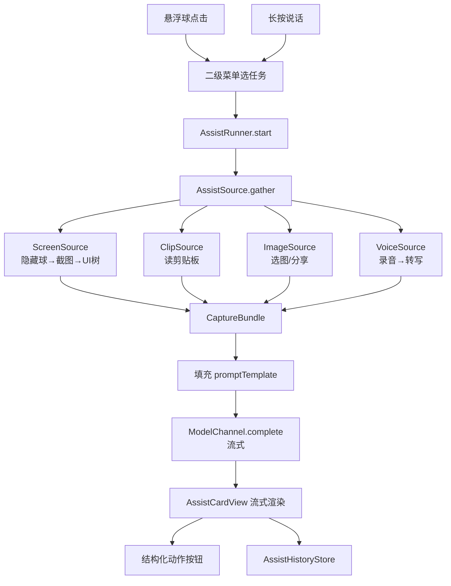

# QuickAssist 落地设计文档（悬浮球快捷 AI）

> 读者对象：熟悉 Java + Android 原生 View 的工程师。
> 前置阅读：`docs/architecture/README.md`（了解可复用模块编号）。
> 本文解决什么问题：把 dsh-Go-java 已有的悬浮窗、无障碍截图、UI 树抓取、模型调用四块能力，拼装成一个"悬浮球 + 快捷任务"的精简 AI 应用。

## 1. 目标与非目标

### 1.1 目标

- 一个**悬浮在所有应用上方**的球体，单击展开快捷功能，长按直接说话。
- 每个功能都是**短链条**：取料 → 一次模型调用 → 渲染结果卡片。**不做多轮 agent loop**。
- 复用现有组件，新增代码控制在 3~5k 行。
- 无网络/无引擎时必须**明确降级**，不能假装工作。

### 1.2 非目标（明确不做）

| 不做 | 原因 |
| --- | --- |
| "总结附近 5km 羽毛球馆"这类多步自动化 | 链条 10+ 步，失败率高、耗电、易触发风控。降级为"识别地址 → 跳地图"。 |
| 后台静默操控其它 App | 无障碍政策与厂商审核风险。 |
| 绕过 `FLAG_SECURE` 截屏 | 系统层面禁止。 |
| 代发消息 / 代付款 | 风险不可控。 |
| 30 个功能平铺一级菜单 | 改用"按取料源分组的二级菜单"。 |

## 2. 产品形态

```
悬浮球（直径 48dp，可拖拽贴边，半透明）
  │
  ├─ 单击 → 展开一级菜单（4 组）
  │        ├─ 屏幕  → 总结 / 提字 / 翻译 / 结构化抽取 / 这是什么
  │        ├─ 网页  → 正文总结 / 翻译 / 就本文提问
  │        ├─ 文本  → 剪贴板总结 / 翻译 / 润色 / 纠错
  │        └─ 图片  → OCR / 翻译 / 识物 / 二维码 / 票据抽取
  │
  ├─ 长按 → 按住说话（松手即转写，再选动作）
  │
  └─ 拖拽到边缘 → 收纳为 32dp 半透明球，静置 5s 后进一步淡出

结果卡片（从球所在侧的边缘滑入，宽 = 屏宽 - 32dp）
  ├─ 流式填充（先骨架后文字）
  ├─ 底部动作：复制 / 分享 / 继续追问（限 1 轮）/ 关闭
  └─ 若抽取出结构化信息 → 追加动作按钮（导航 / 建日程 / 拨号 / 复制）
```

## 3. 现有可复用组件（真实路径与方法）

| 能力 | 复用目标 | 真实入口 |
| --- | --- | --- |
| 跨应用悬浮窗 | `../dsh-Go-java/app/.../pet/PetOverlay.java` | 窗口参数思路（`TYPE_APPLICATION_OVERLAY`）；按同参数新建 |
| 可拖拽悬浮球 | `../dsh-Go-java/app/.../phone/a11y/OverlayBall.java` | `new OverlayBall(Context, WindowManager, Supplier<BallGeometry.SafeArea>, OverlayPalette, Runnable onTap, Runnable onStop)` |
| 截图隐藏协调 | `../dsh-Go-java/app/.../phone/a11y/CaptureVisibility.java` | `boolean update(boolean hide)` / `boolean hidden()` |
| 屏幕截图 | `../dsh-Go-java/app/.../phone/a11y/ScreenShooter.java` | `Shot shoot(UiWindow, UiBox, List<ScreenElement>, List<UiBox>, long timeoutMs, boolean image, boolean readLocalText, boolean localTextPrivacyAllowed, BooleanSupplier)` |
| UI 树文本抓取 | `../dsh-Go-java/app/.../phone/a11y/TreeCapture.java` | `static Capture capture(AccessibilityService, UiBox screen, String ownPackage)` / `static String foregroundPackage(AccessibilityService, UiBox)` |
| OCR 接口 | `../dsh-Go-java/app/.../phone/a11y/LocalOcrBoundary.java`（`LocalOcr` + `NoLocalOcr`） | 默认 `NoLocalOcr`，可插 ML Kit；也可直接交给多模态模型 |
| 手势注入 | `../dsh-Go-java/app/.../phone/a11y/Actuator.java` | 用于"识别后动作" |
| 无障碍服务 | `../dsh-Go-java/app/.../phone/a11y/PhoneA11yService.java` | 已在运行；`ScreenShooter`/`TreeCapture` 都依赖其实例 |
| 模型调用（文本+图片） | `../dsh-Go-java/app/.../state/chat/ChatBackend.java` | `prompt(String sessionId, String text, List<MessagesApi.PromptImage> images, List<String> fileReceiptIds, String requestId, PromptMode mode)` |
| 流式响应 | `ChatBackend.watch(...)` + `Subscription` | 已实现的会话流订阅 |
| 图片结构 | `dsh-client/.../MessagesApi.java` | `record PromptImage(String mediaType, byte[] data, String name)` / `enum PromptMode` |
| 上传大文件 | `ChatBackend.uploadFile(String sessionId, byte[] bytes, String name)` | 返回 `StagedFile`，用于 PDF 等 |
| 带 IME 的输入条 | `../dsh-Go-java/app/.../pet/AskBarView.java` | 已处理 `WindowInsets.Type.ime()`，可改为"提问/追问"条 |
| 语音录制 | `../dsh-Go-java/app/.../voice/WavRecorder.java`、`VoicePlugin` | 按住说话 |
| 设计系统 | `../dsh-Go-java/app/.../theme/`（`DshTheme`、`DshGlyphs`、`GlassStyle`、`AppMotion`） | 卡片视觉与图标字体 |
| 状态容器 | `../dsh-Go-java/app/.../state/StateStore.java` | 观察者式单向数据流 |

**关键约束**：`ScreenShooter` 与 `TreeCapture` 都必须拿到 `AccessibilityService` 实例。因此本功能**依赖用户已开启无障碍**；未开启时屏幕组与语音组之外的功能仍可用（降级路径见 §9）。

### 3.1 跨仓库复用策略（本仓库独立于 dsh-Go-java）

上表组件都在 **`../dsh-Go-java`** 里，本仓库不是它的 Gradle 子项目，因此**不会**通过 `project(':app')` 直接依赖。采用「先复制、后抽库」两步：

| 阶段 | 做法 | 说明 |
| --- | --- | --- |
| P0（当前） | 把需要的类**复制**进 `com.dshgojava.assist.platform`，包名改为本仓库命名空间 | 起步快；只需 6~8 个类（`ScreenShooter` 及其依赖的 `UiBox`/`Capture`/`LocalOcr` 边界、`TreeCapture`、`CaptureVisibility`、悬浮窗参数工具） |
| 后续（可选） | 把公共能力抽成 `dsh-go-core` library 模块，两个仓库都引用 | 单一事实来源；需先改 `dsh-Go-java` 的模块划分 |

**复制时的硬性要求**：不改动原仓库代码；复制后若发现缺陷（如本项目踩过的 insets 中间态、`StringBuilder.isEmpty()`），**必须同时修两处**并在任务文档记录。

**模型通道**：本仓库**不引入** `dsh-client`。P0 使用 `model/DirectApiModelChannel`——用 OkHttp 直连 OpenAI 兼容的 Chat Completions 接口（`/v1/chat/completions`，SSE 流式），自建 `PromptImage` record 承载图片。若后续要与 dsh-Go 本机引擎共用会话，再单独引入 `dsh-client` 并新增 `SessionModelChannel`。

## 4. 模块与包结构

本仓库是**独立的单模块 Android 应用**（不是 `../dsh-Go-java` 的 Gradle 子项目）。所有代码放在 `app` 模块的 `com.dshgojava.assist` 包下，不新建 Gradle 模块。

```
app/src/main/java/com/dshgojava/assist/
├── QuickTask.java            任务声明（不可变 record）
├── SourceKind.java           取料源枚举
├── OutputKind.java           输出形态枚举
├── AssistRequest.java        一次请求（task + 附加上下文 + 用户补充）
├── AssistResult.java         一次结果（状态 + 流式文本 + 结构化字段 + 错误）
├── AssistAction.java         结构化动作
├── TaskRegistry.java         P0/P1 任务表（唯一"加功能"入口）
├── AssistRunner.java         调度接口
├── DefaultAssistRunner.java  调度实现
├── A11yBridge.java           静态持有 PhoneA11yService，供 Source 取截图/树
├── source/
│   ├── AssistSource.java     取料接口
│   ├── CaptureBundle.java    取料产物
│   ├── ScreenSource.java     截图 + UI 树
│   ├── WebSource.java        DOM（仅本 App web 模式）/ 降级截图
│   ├── ClipSource.java       剪贴板
│   ├── ImageSource.java      相册 / 分享 / 最近截图
│   └── VoiceSource.java      按住说话 → 转写
├── model/
│   ├── ModelChannel.java         模型通道接口
│   ├── SessionModelChannel.java  绑定宿主已有 ChatBackend + 专用会话
│   └── NullModelChannel.java     未连接时的显式失败实现
├── ui/
│   ├── AssistBall.java       包装 OverlayBall（球 + 二级菜单）
│   ├── AssistMenuView.java   圆环/列表菜单
│   ├── AssistCardView.java   结果卡片（流式）
│   ├── AssistCardLayer.java  卡片层窗口管理（含拖拽关闭）
│   └── AssistAskBar.java     追问输入条（复用 AskBarView 思路）
├── service/
│   └── AssistOverlayService.java  前台服务：球 + 卡片 + 生命周期
└── store/
    ├── AssistHistoryStore.java    本地历史（JSON 文件，最多 200 条）
    └── AssistPrefs.java           开关、默认通道、球位置
```

## 5. 核心接口

```java
public enum SourceKind { SCREEN, WEB, CLIP, IMAGE, VOICE, NONE }

public enum OutputKind { TEXT_CARD, COPY_TEXT, TRANSLATE_CARD, ACTION_SHEET }

/** 加功能只需在 TaskRegistry 里加一行。 */
public record QuickTask(
        String id,
        String title,
        SourceKind source,
        OutputKind output,
        String promptTemplate,
        boolean needsVision
) {}

/** 一次取料产物。text 与 images 至少一个非空。 */
public record CaptureBundle(
        String text,
        java.util.List<PromptImage> images,
        java.util.Map<String, String> meta
) {}

public interface AssistSource {
    SourceKind kind();
    /** 未开无障碍 / 未连接 / 权限缺失时返回 false，UI 据此灰显。 */
    boolean available();
    java.util.concurrent.CompletableFuture<CaptureBundle> gather(AssistRequest request);
}

public interface ModelChannel {
    boolean ready();
    /** 流式：onDelta 会被多次调用；返回完整文本。 */
    java.util.concurrent.CompletableFuture<String> complete(
            String prompt,
            java.util.List<PromptImage> images,
            java.util.function.Consumer<String> onDelta);
}

public interface AssistRunner {
    AssistRun start(QuickTask task, AssistRequest request);

    interface AssistRun extends AutoCloseable {
        com.dshgojava.app.state.StateStore<AssistResult> state();
        void cancel();
        @Override void close();
    }
}
```

`AssistResult` 为不可变快照：

```java
public record AssistResult(
        Stage stage,            // IDLE / GATHERING / THINKING / STREAMING / DONE / FAILED / CANCELLED
        String text,
        java.util.List<AssistAction> actions,   // 结构化动作按钮
        String error
) {}
```

## 6. 数据流



## 7. 任务注册表（P0 / P1）

`TaskRegistry` 是唯一新增功能入口。P0 只做 8 个：

| id | 标题 | source | output | needsVision |
| --- | --- | --- | --- | --- |
| `screen.summarize` | 总结当前屏幕 | SCREEN | TEXT_CARD | false（有树用树） |
| `screen.extract` | 提取屏幕文字 | SCREEN | COPY_TEXT | false |
| `screen.translate` | 翻译当前屏幕 | SCREEN | TRANSLATE_CARD | false |
| `screen.what` | 这是什么 | SCREEN | TEXT_CARD | true |
| `clip.summarize` | 总结剪贴板 | CLIP | TEXT_CARD | false |
| `clip.polish` | 润色/纠错 | CLIP | TEXT_CARD | false |
| `image.ocr` | 图片取字 | IMAGE | COPY_TEXT | true |
| `image.explain` | 图片解说 | IMAGE | TEXT_CARD | true |

P1 追加：`web.summarize`、`web.ask`、`voice.transcribe`、`image.qr`（ZXing，不走模型）、`screen.actions`（结构化抽取 + 导航/日程/拨号）、`pdf.summarize`（走 `uploadFile`）。

**提示词模板约定**：模板里用 `{{text}}` 占位；`needsVision=false` 且文本为空时直接判失败（不浪费一次调用）。

## 8. 关键实现细节

### 8.1 截图必须隐藏悬浮球

复用 `CaptureVisibility`：截图前 `update(true)`，`finally` 里 `update(false)`。否则每次 OCR 都会把球识别进去。

### 8.2 有 UI 树就不要用视觉

`TreeCapture.capture(...)` 拿到的节点文本，其精度和成本都远优于截图 + 多模态。策略：

1. 先 `TreeCapture.capture(...)`；
2. 若文本长度 < 40 字符（说明是画布/视频/游戏）或 `needsVision=true`，再走截图；
3. 两者都失败 → `FAILED`，提示"当前页面无法读取"。

### 8.3 截图降采样

`ScreenShooter` 返回的是有界 JPEG，但仍需再检查：长边 > 1024 时缩放到 1024（`BitmapFactory.Options.inSampleSize` 逐级减半）。token 能省约一个数量级。

### 8.4 流式与骨架

`ModelChannel.complete` 的 `onDelta` 在后台线程回调；`AssistCardView` 内部 `post()` 到主线程 + 每 80ms 合并一次刷新，避免 `Skipped frames`。首字延迟通常 1~3s，卡片要先显示骨架屏。

### 8.5 线程

- 截图/OCR/剪贴板读取/模型调用：**全部离开主线程**（`Executors.newSingleThreadExecutor`）。
- 只有 `View` 操作在主线程。

### 8.6 IME

追问条必须 `FLAG_WATCH_OUTSIDE_TOUCH` + `SOFT_INPUT_ADJUST_NOTHING`，并监听 `WindowInsets.Type.ime()`（参考 `AskBarView`）。系统栏 insets 存在"重排期间短暂变 0"的问题，必须做**忽略回退 + 缓存上次有效值**（同 `ChatHomeView` 的 `resolveInset` 策略）。

### 8.7 悬浮层双通道（无障碍覆盖层优先）

**问题**：Android 12（API 31）起，**任何应用**都可以调用 `Window.setHideOverlayWindows(true)`，系统会立刻隐藏所有 `TYPE_APPLICATION_OVERLAY` 窗口。金融、银行、支付类应用在行情／交易／持仓等敏感页普遍启用它，于是"球在微信能看到、在东方财富看不到"。这是系统级安全策略，**无法绕过，也不应该绕过**（它的目的就是防止悬浮窗遮挡交易确认与密码输入）。

**解法**：用两种窗口类型，按无障碍是否连接自动选：

| 通道 | 窗口类型 | 值 | 会被 `setHideOverlayWindows` 隐藏 | 前置条件 |
| --- | --- | --- | --- | --- |
| ACCESSIBILITY | `TYPE_ACCESSIBILITY_OVERLAY` | 2032 | **不会**（受信任的辅助功能窗口） | 无障碍服务已连接 |
| APPLICATION | `TYPE_APPLICATION_OVERLAY` | 2038 | 会 | `SYSTEM_ALERT_WINDOW` 已授权 |

选择规则（`AssistOverlayService.preferredChannel()`）：无障碍已连接 → ACCESSIBILITY；否则 → APPLICATION。

**实现要点**：

1. App 侧的 `WindowManager` 无法创建 `TYPE_ACCESSIBILITY_OVERLAY`，必须用 `AccessibilityService` 实例作为 `Context` 取 `WindowManager`（`A11yBridge.service().getSystemService(WindowManager.class)`）。
2. 球、结果卡片、语音 HUD、菜单**必须使用同一个通道**，否则会出现一部分窗口可见、一部分被隐藏。
3. 无障碍连接／断开时**不重启前台服务**，只重建窗口：`A11yBridge.addConnectionListener(...)` → `rebuildOverlay(kind)`，先 `detach` 旧窗口再按新通道 `createBall()`。
4. 通道不可用时按通道给不同引导：无障碍通道 → 无障碍设置；应用悬浮窗通道 → `ACTION_MANAGE_OVERLAY_PERMISSION`。
5. **降级行为**：两者都不可用时，服务不启动并发出通知，绝不静默失败。

**能力边界**（务必告知用户）：悬浮窗可见 ≠ 能读屏。金融 App 的 `FLAG_SECURE` 页面既禁截图也禁无障碍取树，此时屏幕组任务仍会返回 `assist_error_secure_screen`。

### 8.8 会话与上下文

P0 的 `DirectApiModelChannel` **不走服务端会话**：每次任务组装一条 `messages` 数组（system + user）直接请求 `/v1/chat/completions`，无状态、无会话垃圾。只有"追问 1 轮"时把上一轮结果并入 `messages` 再发一次。

API key 与 baseUrl 由设置页写入（`AssistPrefs`），存储用 `EncryptedSharedPreferences`（`androidx.security:security-crypto`）或最简的私有目录文件 + `MODE_PRIVATE`；**不得**写进日志或历史记录。

### 8.9 未连接 / 无模型的显式失败

`NullModelChannel.ready()` 返回 `false`，`complete` 直接 `failedFuture(new IllegalStateException("未配置模型"))`。UI 显示"未连接，点此去设置"，**不允许静默无响应**。

## 9. 降级矩阵

| 场景 | 行为 |
| --- | --- |
| 无无障碍服务 | 屏幕组灰显；提示"开启无障碍以读取屏幕"；剪贴板/图片组可用 |
| 无悬浮窗权限 | 启动时引导 `Settings.ACTION_MANAGE_OVERLAY_PERMISSION` |
| 未连接模型 | 任务入口灰显 + "去连接" |
| 当前页是 `FLAG_SECURE` | 截图返回失败，提示"该页面禁止截图" |
| 当前页是第三方 WebView | `WebSource` 退回截图 + 视觉，不使用 DOM |
| 模型不支持视觉 | `needsVision=true` 的任务灰显 |
| 网络失败 | 卡片显示错误 + 重试按钮（仅重试模型调用，不重新取料） |

## 10. 权限与合规

```xml
<uses-permission android:name="android.permission.SYSTEM_ALERT_WINDOW" />
<uses-permission android:name="android.permission.FOREGROUND_SERVICE" />
<uses-permission android:name="android.permission.FOREGROUND_SERVICE_SPECIAL_USE" />
<uses-permission android:name="android.permission.POST_NOTIFICATIONS" />
```

- 无障碍服务声明沿用 `phone_accessibility_service.xml`，**不新增**服务（复用 `PhoneA11yService`）。
- 首次启动必须展示**用途说明**（读取屏幕内容仅用于你主动触发的任务），并给出关闭开关。
- 历史记录默认**仅本地**、可按条删除、可在设置里一键清空。
- 不记录 API key / token；日志脱敏沿用 `DiagnosticsRedactor`。

## 11. 里程碑与验收

| 阶段 | 范围 | 验收标准 |
| --- | --- | --- |
| **QA-P0** | 球 + 菜单 + 4 个屏幕任务 + 2 个剪贴板任务 + 2 个图片任务 | 在微信/浏览器/相册三个 App 上方，点击球完成"总结当前屏幕"，卡片流式出结果；无无障碍时入口灰显 |
| **QA-P1** | 网页组、语音组、二维码、结构化动作、历史 | 长按说话转写成功；识别到地址出"导航"按钮 |
| **QA-P2** | PDF 摘要、通知摘要、常用提示词胶囊 | PDF 走 `uploadFile` 成功出摘要 |

每个阶段完成定义：代码编译通过 + 关键状态机有 JUnit 测试 + 真机冒烟记录（截图/日志）+ 进度行写入。

## 12. 文件清单

**新建（约 30 个文件）**

- `assist/` 根：`QuickTask`、`SourceKind`、`OutputKind`、`AssistRequest`、`AssistResult`、`AssistAction`、`TaskRegistry`、`AssistRunner`、`DefaultAssistRunner`、`A11yBridge`
- `assist/source/`：`AssistSource`、`CaptureBundle`、`ScreenSource`、`WebSource`、`ClipSource`、`ImageSource`、`VoiceSource`
- `assist/model/`：`ModelChannel`、`SessionModelChannel`、`NullModelChannel`
- `assist/ui/`：`AssistBall`、`AssistMenuView`、`AssistCardView`、`AssistCardLayer`、`AssistAskBar`
- `assist/service/`：`AssistOverlayService`
- `assist/store/`：`AssistHistoryStore`、`AssistPrefs`
- `assist/platform/`：从 `../dsh-Go-java` 复制并按本仓库包名改写的底层能力（`OverlayBall`、`CaptureVisibility`、`ScreenShooter`、`TreeCapture` 等）
- `assist/model/PromptImage.java`：本仓库自定义的图片载荷（`mediaType`/`data`/`name`）
- 资源：`res/values/quick_assist_strings.xml`、`res/values-zh/quick_assist_strings.xml`、`res/drawable/ic_assist_*.xml`

**修改（3 个文件）**

- `AndroidManifest.xml`：新增 `AssistOverlayService` + 权限
- `res/values/strings.xml` / `values-zh/strings.xml`：设置入口文案
- 设置页：新增"悬浮助手"开关与权限引导入口

**复制自 `../dsh-Go-java`（复制到 `assist/platform/`，包名改为 `com.dshgojava.assist.platform`）**：`OverlayBall`、`CaptureVisibility`、`ScreenShooter`、`TreeCapture`、`LocalOcr` 边界、`Actuator`；窗口参数思路参考 `PetOverlay`。

**本仓库自建（不复制）**：`PromptImage`、`ModelChannel` 系列、`StateStore`（极简版，观察者 + 快照）、卡片视觉（不引入 `dsh-Go-java` 的 `theme/`，改用 `androidx` 原生样式，避免连带依赖 `DshGlyphs` 字体资源）。
